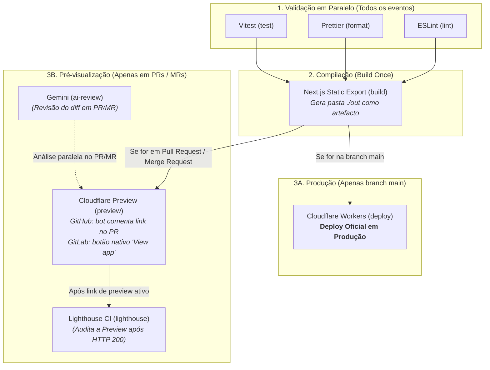

# Relatório Técnico: Implementação e Replicação de Pipeline CI/CD

**Unidade Curricular:** Tecnologias de Desenvolvimento Web (TDW) — Módulo 1A (2026/2027)  
**Autor:** Carlos Teixeira  
**Repositório GitHub:** [https://github.com/CarlT09/tdw-mp1-carlos-teixeira](https://github.com/CarlT09/tdw-mp1-carlos-teixeira)  
**Repositório GitLab:** [https://gitlab.com/tdw-mp1-group/tdw-mp1-carlos-teixeira](https://gitlab.com/tdw-mp1-group/tdw-mp1-carlos-teixeira)  
**URL de Produção (Cloudflare Workers):** [https://tdw-mp1.carlosteixeira05.workers.dev](https://tdw-mp1.carlosteixeira05.workers.dev)

---

## 1. O Desafio e o Objetivo do Trabalho

Neste trabalho, o objetivo foi construir a infraestrutura de automação (CI/CD) para levar uma aplicação Next.js (TypeScript) integrada com o Contentful Headless CMS até à produção no Cloudflare Workers.

O foco esteve em aplicar boas práticas: usar branches de funcionalidade (_feature branches_), proteger a branch `main` com Pull Requests obrigatórios, validar a qualidade antes da compilação e replicar toda a lógica no GitLab CI/CD, comparando as duas plataformas.

---

## 2. Escolha da 2ª Plataforma: GitLab CI/CD

Para replicar a pipeline do GitHub Actions, escolhi o **GitLab CI/CD** por três razões:

- É uma referência na indústria e no mercado de trabalho em DevOps.
- Tem uma abordagem distinta do GitHub: corre diretamente em contentores Docker (`node:22`) organizados por estágios (_stages_).
- Possui suporte nativo a _Review Apps_ (ambientes dinâmicos), permitindo comparar a gestão de pré-visualizações entre ecossistemas.

---

## 3. Como Estruturei a Pipeline de CI/CD

Em vez de correr todas as tarefas em fila indiana, estruturei a pipeline para otimizar o tempo de execução e garantir que nenhum código com erros chega a produção.

### 3.1. Validações em Paralelo

Tanto no GitHub Actions (`.github/workflows/ci.yml`) como no GitLab (`.gitlab-ci.yml`), a pipeline começa por correr três verificações ao mesmo tempo:

1. **ESLint (`lint`):** Confirma se não há erros de sintaxe ou de regras de código.
2. **Prettier (`format`):** Confirma se o estilo e a formatação do código estão consistentes.
3. **Vitest (`test`):** Corre os testes unitários.

O passo seguinte (`build`) só arranca se estes três trabalhos passarem com sucesso (através da instrução `needs: [lint, format, test]`).

### 3.2. Compilar uma só vez (_Build Once_)

Uma preocupação importante foi não perder tempo a compilar a aplicação várias vezes. No job `build`, o Next.js gera a versão estática do site para a pasta `./out` (`output: 'export'`). Esta pasta é guardada como um artefacto da pipeline.

Depois, os jobs que precisam desses ficheiros (tanto o `deploy` de produção como o `preview` de teste) limitam-se a descarregar essa mesma pasta e a enviá-la para a Cloudflare através da ferramenta `wrangler`. Isto garante que aquilo que foi testado é exatamente aquilo que vai para a nuvem.

### 3.3. Comportamento: Branch `main` vs. Branches de Teste (PR / MR)

A pipeline distingue de forma clara o destino das alterações para proteger a versão de produção:

- **Se o código for para a branch `main`:** A pipeline avança do `build` diretamente para o job de **`deploy`**, atualizando o site oficial na Cloudflare Workers (`https://tdw-mp1.carlosteixeira05.workers.dev`). Os jobs de pré-visualização e auditoria são ignorados, pois a `main` é a versão estável final.
- **Se estivermos numa branch que não a `main` (em Pull Request ou Merge Request):** O deploy de produção é bloqueado. Em vez disso, a pipeline gera um ambiente de pré-visualização (**`preview`**) com um URL temporário na Cloudflare:
  - **No GitHub Actions:** O bot automatizado (`github-actions[bot]`) publica um comentário diretamente na discussão do Pull Request com o link de teste.
  - **No GitLab CI/CD:** O GitLab ativa o seu mecanismo nativo de **Review Apps**, colocando logo no topo do Merge Request um botão interativo **"View app"** para abrir o site de teste sem encher o histórico de comentários.
  - **Auditoria com Lighthouse CI:** Apenas nos PRs/MRs (e após o link de preview responder `HTTP 200`), o job **`lighthouse`** executa a auditoria de Performance, Acessibilidade e SEO sobre a URL de preview.
  - **Revisão IA:** O job **`ai-review`** analisa o diff do código com o Gemini exclusivamente durante o PR/MR.

### 3.4. Gestão de Segredos e Gatilhos

Nenhum token ou chave secreta foi colocado no código:

- **Segredos:** Chaves de API (`CLOUDFLARE_API_TOKEN`, `CONTENTFUL_ACCESS_TOKEN`, `GEMINI_API_KEY`) foram configuradas em _Secrets_ no GitHub e em variáveis mascaradas (_Masked_) no GitLab. Identificadores normais (`CLOUDFLARE_ACCOUNT_ID`, `CONTENTFUL_SPACE_ID`) ficaram como variáveis comuns.
- **Gatilho Contentful:** Quando crio ou edito um artigo no CMS, o Contentful dispara um webhook (`repository_dispatch`) que manda a pipeline reconstruir o site automaticamente.
- **Agendamento diário (`schedule`):** Configurei o cron para correr à meia-noite (`0 0 * * *`). Após confirmar que funcionava, comentei-o no YAML (com nota explicativa), cumprindo o pedido do enunciado para poupar minutos de CI/CD.

---

## 4. Extras e Bónus Implementados

Para além dos requisitos base, implementei várias melhorias práticas:

1. **100% de Cobertura de Testes (Vitest):** Configurei a medição de cobertura com o `@vitest/coverage-v8` cobrindo 100% das linhas, funções e ramificações. Adicionei os badges no `README.md` do GitHub e configurei uma expressão regular no GitLab para mostrar os 100% no Merge Request.
2. **Testes de Snapshot:** Adicionei testes de snapshot com Vitest no ficheiro `constants.test.ts` para garantir que configurações fixas não mudam por acidente.
3. **Auditoria com Lighthouse CI:** Tanto no GitHub como no GitLab, adicionei um job que audita o link de preview na Cloudflare, avaliando Performance, Acessibilidade e SEO antes do merge.
4. **Revisor de Código com Inteligência Artificial (Google Gemini):** Criei um script em Node.js (`scripts/ai-review.mjs`) que lê o _diff_ do PR/MR e pede uma revisão técnica ao modelo `gemini-2.0-flash`. O script é independente de plataforma e corre da mesma forma no GitHub e no GitLab.

---

## 5. Comparação Prática: GitHub Actions vs. GitLab CI/CD

Ao replicar a pipeline no GitLab, notei diferenças evidentes no funcionamento de cada plataforma:

| Aspeto                       | GitHub Actions                                                          | GitLab CI/CD                                                                                                 |
| :--------------------------- | :---------------------------------------------------------------------- | :----------------------------------------------------------------------------------------------------------- |
| **Estrutura**                | Ficheiro baseado em eventos (`on: push, pull_request`).                 | Ficheiro baseado em estágios (`stages: validate, build, deploy`).                                            |
| **Ambiente**                 | Corre em máquinas virtuais Ubuntu completas (`runs-on: ubuntu-latest`). | Corre em contentores Docker limpos (`image: node:22`).                                                       |
| **Cache de dependências**    | Fácil de ativar através do `cache: npm` no `setup-node`.                | Definido manualmente indicando a pasta `.npm/` e a chave baseada no `package-lock.json`.                     |
| **Links de Teste (Preview)** | O bot comenta o link do preview na discussão do PR.                     | O GitLab tem suporte nativo para **Review Apps**, colocando logo um botão "View app" no Merge Request.       |
| **Controlo de Pipelines**    | Cada job avalia os seus `if:` de forma independente.                    | Foi necessário usar `workflow: rules:` no topo para evitar que o GitLab criasse duas pipelines concorrentes. |
| **Variáveis Protegidas**     | Os segredos ficam disponíveis em todas as branches por defeito.         | No GitLab há o visto "Protect variable"; se ativo, as variáveis só vão para a `main`, falhando em branches.  |

---

## 6. Problemas Reais que Tive e Como Resolvi

Durante o desenvolvimento deparei-me com alguns obstáculos práticos:

- **Conflito de dependências no Node 22 com o Vitest:** Ao correr `npm ci` dava erro de pacotes. Resolvi criando um ficheiro `.npmrc` com `legacy-peer-deps=true` e regerei o `package-lock.json`.
- **Configuração da proteção de branch no GitHub:** No início o merge ficava bloqueado porque tinha selecionado verificações manuais. Alinhei as regras com os nomes dos jobs (`lint`, `format`, `test`).
- **Tempo de espera do link de preview na Cloudflare:** Quando o comando do Wrangler terminava, o URL às vezes demorava alguns segundos a responder na internet. Criei um ciclo de espera simples que faz pedidos até o site responder `HTTP 200` antes de arrancar com o Lighthouse.
- **Pipelines duplicadas no GitLab:** Quando abri o Merge Request no GitLab, o `preview` não encontrava o `build` porque o GitLab estava a gerar duas pipelines ao mesmo tempo. Resolvi adicionando a diretiva `workflow: rules:` que unificou o fluxo.
- **Ajuste na API do Gemini:** Inicialmente tive erros 404 porque o nome do modelo variava. Atualizei o script para interrogar a API sobre os modelos disponíveis na chave e aumentei o limite de tokens (`maxOutputTokens: 2500`) para a análise não ficar cortada.

---

## 7. O que Aprendi e Conclusão

Este trabalho permitiu-me perceber na prática como funciona uma pipeline profissional de CI/CD e porque é que estas ferramentas são fundamentais no dia a dia. Ao implementar tudo passo a passo, compreendi o valor de ter a certeza de que nenhum código com falhas chega a produção.

A experiência de replicar tudo no GitLab foi especialmente enriquecedora, provando que o essencial são os conceitos base: isolar tarefas, reutilizar artefactos, proteger credenciais e garantir processos repetíveis. Ambas as pipelines ficaram totalmente funcionais, verdes e com paridade completa.
